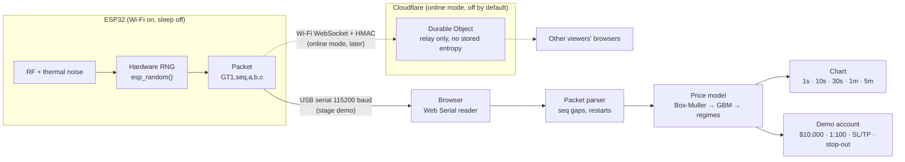
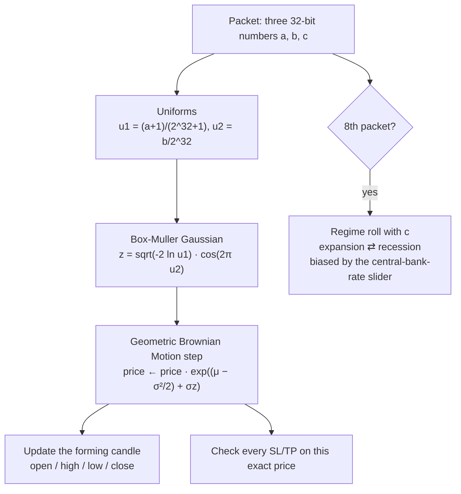

# GhostTape

**A trading chart where every price move comes from physical noise inside a microchip.**

GhostTape is a TradingView-style chart with an MT5-style demo trading terminal. The instrument, `GHOST/USD`, is
completely synthetic: each step of its price comes from the hardware random number generator of an **ESP32**,
which samples radio-frequency and thermal noise. You can draw trendlines, add indicators, place long and short
positions with stop-loss and take-profit, and watch margin calls happen, all on a market that is
**pure noise by construction**.

The point: traders often "see" patterns in charts. On GhostTape any pattern you see is guaranteed to predict
nothing, because there is nothing underneath it but physics.

> ⚠️ **Synthetic tape, not real market data.** Demo account only. No real money, no broker, no execution.
> Not financial advice and not a trading signal.

---

## Status

| Phase | What | Status |
|---|---|---|
| 0 | Safe project setup (guard hooks, leak scanner, owner-only limits) | ✅ done |
| 1 | ESP32 firmware streaming hardware random packets over USB | ✅ done (1,000 packets, 0 gaps) |
| A | Price engine + MT5 account maths, unit-tested | ⏳ next |
| B | TradingView-style terminal (light theme, drawing tools, position boxes, indicators) | planned |
| C | Live ESP32 mode in the browser (Web Serial), freezes when unplugged | planned |
| D | Randomness proof notebook (Google Colab) | planned |
| E | Online version on Cloudflare (Worker + Durable Object relay) | planned |
| F | Replay, share links, mobile, "why patterns appear in noise" page | planned |

A working prototype of the idea lives in [`prototype/index.html`](prototype/index.html).

---

## How it works

### The whole system



### One packet = one price step



| Regime | Drift μ per step | Volatility σ per step |
|---|---|---|
| Expansion | +0.0006 | 0.009 |
| Recession | −0.0009 | 0.020 |

Higher central-bank rates make a slide into recession more likely, the same direction as real monetary policy.

### Unplug it and the market stops

There is **no stock of random numbers** anywhere between the chip and the chart. Each number is used exactly once.
Pull the USB cable and the candles freeze within about 0.2 seconds, because there is nothing left to move them.
Demo mode (browser randomness) exists for testing and is always labelled as such.

---

## Why the ESP32's numbers count as truly random

Espressif's documentation for the ESP32 states that its hardware RNG produces true random numbers **only while
the RF subsystem is enabled (Wi-Fi or Bluetooth on) and not asleep**, or while `bootloader_random_enable()` is
active. Otherwise the output should be treated as pseudo-random. GhostTape's firmware therefore keeps Wi-Fi in
station mode with power-saving sleep disabled.

Honest note: no statistical test can *prove* randomness. Tests can only fail to find patterns, and a good software
generator passes them too. The difference is the source: a software generator replays the exact same sequence
from the same seed, while the ESP32's numbers come from physical noise and can't be replayed. The proof notebook
shows both sides.

## Randomness proof notebook

*Coming in Phase D.* A Google Colab notebook will compare a 10 MB ESP32 capture against:

- Python's Mersenne Twister (MT19937)
- NumPy's PCG64
- the operating system's cryptographic generator
- **RANDU**, a famously bad 1960s generator, included to show the tests can catch bias

Tests include byte histograms, chi-square, entropy per byte, serial correlation, Monte-Carlo π, NIST frequency and
runs tests, bitmap images and autocorrelation, plus `ent`, dieharder and PractRand results. Screenshots and the
Colab link will appear here.

---

## Tech stack

| Layer | Choice |
|---|---|
| Firmware | C++ (Arduino core 3.x for ESP32) |
| Web app | TypeScript + Vite |
| Chart | Open-source charting library (KLineChart or TradingView Lightweight Charts, decided by a spike), Apache-2.0 |
| Browser ↔ ESP32 | Web Serial API (Chrome / Edge desktop) |
| Online relay | Cloudflare Workers + Durable Objects (WebSocket hibernation) |
| Proof | Python, Google Colab, ent, dieharder, PractRand |
| Tests | Vitest (model and account maths), guard test suite |

## Repository layout

```
firmware/ghosttape_esp32/   ESP32 sketch (packet stream + capture mode)
tools/capture.py            dumps raw ESP32 bytes for statistical tests
prototype/index.html        single-file working prototype (reference)
docs/SPEC.md                full build spec: model, protocol, phases
limits.jsonc                owner-only quota and trading limits
.claude/hooks/              safety guard for AI-assisted development (+ tests)
.githooks/                  pre-push secret/leak scanner
```

## Running it locally

```bash
npm install
npm test          # limits check + guard test suite
```

The web app arrives in Phase B. To see the idea today, open `prototype/index.html` in Chrome or Edge.

## Safety by design

This project is built with an AI coding assistant under hard guard rails:

- a pre-tool **guard hook** blocks deploys, pushes and repo changes unless the owner explicitly says "GO",
  and fails closed if it ever crashes;
- **quota limits are owner-only**: the AI can't change them, and the server enforces them;
- a **pre-push leak scanner** blocks API keys, Wi-Fi passwords and device secrets from ever being published.

## Credits

Built by Praveen Banneka. Charting by open-source libraries credited in `THIRD_PARTY_NOTICES.md` (added with the
chart in Phase B). GhostTape is not affiliated with TradingView or MetaQuotes.
