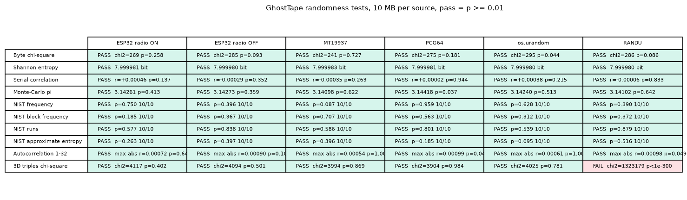
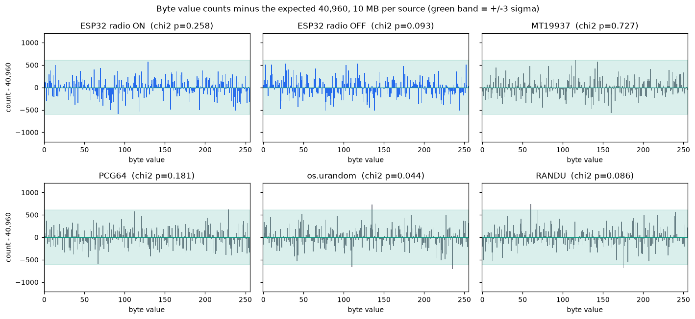
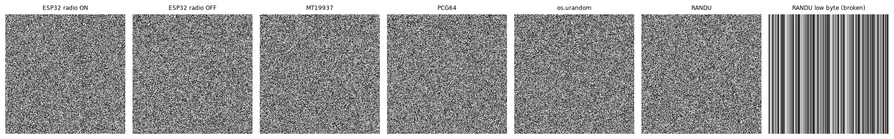
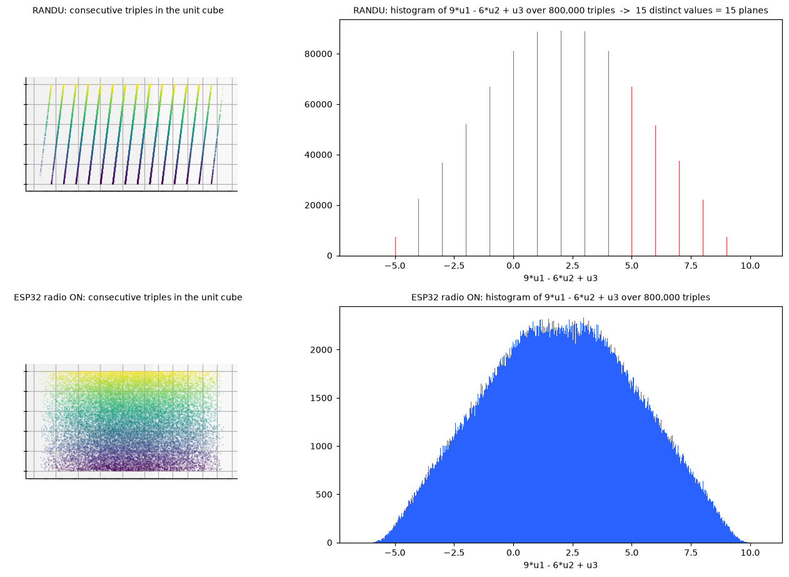
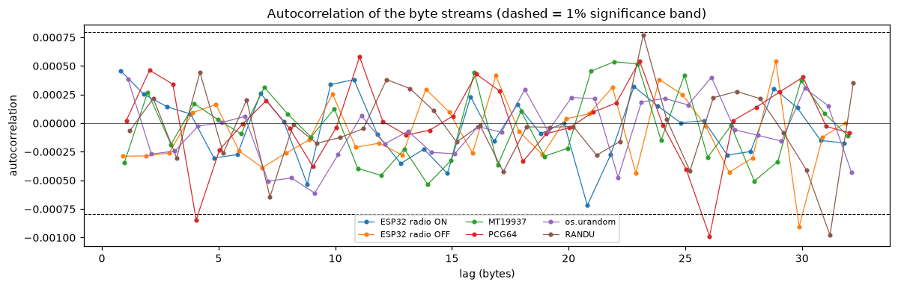

# GhostTape randomness proof: results

**Date:** 2026-10-05 · **Board:** ESP32-D0WD-V3 rev 3.1 (CP210x on COM5), arduino-esp32 core 3.3.0 ·
**Notebook:** [`notebooks/randomness_proof.ipynb`](../../notebooks/randomness_proof.ipynb) (runs locally and in Google Colab)

## Short version

The ESP32's radio-on stream shows **no detectable pattern** in any of the 10 tests, exactly like three good software
generators. So does the same chip with its radio **off**, and so do generators that are fully predictable from a
seed. Tests cannot prove "true random"; they prove nothing is broken, and they are sharp enough to catch the
known-bad RANDU generator. GhostTape's "true random" claim rests on the physical source plus the firmware's radio
verification (below), not on these scores.

## Captures

| File (in `data/`, git-ignored) | Firmware build | Size | Capture time |
|---|---|---|---|
| `esp32_radio_on.bin` | `-DCAPTURE_MODE=1` (Wi-Fi STA on, sleep off, scan-verified) | 10,485,760 bytes (10 MB) | 113.7 s at 90.1 KB/s |
| `esp32_radio_off.bin` | `-DCAPTURE_MODE=1 -DRADIO_OFF_CONTROL=1` (`WiFi.mode(WIFI_OFF)`, pseudo-random control) | 10,485,760 bytes (10 MB) | 113.7 s at 90.1 KB/s |
| `esp32_radio_on_2.bin` | `-DCAPTURE_MODE=1`, separate boot | 1,048,576 bytes (1 MB) | 11.4 s |

Captured with `python tools/capture.py COM5 <file> <MB>` at 921,600 baud (the link's full speed: 921,600 / 10 bits =
90 KB/s). `capture.py` opens the port without a reset pulse and discards the first second of stream; the notebook
also scans each file for boot or status text (`ets `, `rst:`, `boot:`, `GT1,`) and finds none.

## Radio verification evidence

Espressif (ESP-IDF, ESP32 "Random Number Generation"): `esp_random()` is a true RNG only while the RF subsystem is
on (Wi-Fi/BT enabled, not asleep) or while `bootloader_random_enable()` is active; otherwise treat it as
pseudo-random. The firmware turns Wi-Fi STA on, disables modem sleep, runs one Wi-Fi scan (a completed scan proves
the radio is physically running) and re-checks mode + power-save every 30 s. It sends **nothing** unless that
passes, in live mode and in `CAPTURE_MODE=1` alike, so the radio-on capture could only have streamed after a
verified bring-up. The `RADIO_OFF_CONTROL` build is a capture-only control: it refuses to compile without
`CAPTURE_MODE=1` (`#error`), so it can never feed the live tape.

After the captures the normal live firmware (no `-D` flags) was re-flashed and `tools/phase1-check.ps1` run:

```
radio         : 6 INFO line(s), 0 ERR line(s)
  first INFO  : GT1,INFO,radio=on,ps=none,aps=2,up=2   (from the saved packet log, boot line)
  last INFO   : GT1,INFO,radio=on,ps=none,aps=2,up=153
valid packets : 1000 / 1000
gaps          : 0
restarts      : 0
rate          : 6.25 packets/s (expected ~6 at 160 ms)
bit balance   : 47,842 ones of 96,000 bits = 0.4984 (z = -1.02; |z| < 3 is normal)
RESULT: PASS
```

## Sources compared (10 MB each)

| Source | What it is |
|---|---|
| ESP32 radio ON | `esp_random()` with the radio verified on: true random per Espressif |
| ESP32 radio OFF | same chip, Wi-Fi off: pseudo-random per Espressif (the honesty control) |
| MT19937 | Python `random.getrandbits`, seed 20261005 |
| PCG64 | NumPy `default_rng(20261005).bytes` |
| os.urandom | the OS CSPRNG (new bytes every run, so this column changes each time) |
| RANDU | IBM LCG x(n+1) = 65539 * x(n) mod 2^31, seed 1, top 8 of 31 bits per output (its best bits) |

## Results

Pass = p >= 0.01 (entropy: >= 7.9995 bits/byte). NIST SP 800-22 tests (frequency, block frequency with M = 20,000,
runs, approximate entropy with m = 10) show the p-value of the first 1-Mbit sequence and how many of 10 disjoint
1-Mbit sequences passed (NIST's acceptable proportion for 10 sequences is 9). Autocorrelation uses a Bonferroni
correction over lags 1-32. The 3D triples test bins three consecutive bytes into a 16 x 16 x 16 cube.

| Test | ESP32 radio ON | ESP32 radio OFF | MT19937 | PCG64 | os.urandom | RANDU |
|---|---|---|---|---|---|---|
| Byte chi-square | **PASS** chi2=269 p=0.258 | **PASS** chi2=285 p=0.093 | **PASS** chi2=241 p=0.727 | **PASS** chi2=275 p=0.181 | **PASS** chi2=295 p=0.044 | **PASS** chi2=286 p=0.086 |
| Shannon entropy | **PASS** 7.999981 bit | **PASS** 7.999980 bit | **PASS** 7.999983 bit | **PASS** 7.999981 bit | **PASS** 7.999980 bit | **PASS** 7.999980 bit |
| Serial correlation | **PASS** r=+0.00046 p=0.137 | **PASS** r=-0.00029 p=0.352 | **PASS** r=-0.00035 p=0.263 | **PASS** r=+0.00002 p=0.944 | **PASS** r=+0.00038 p=0.215 | **PASS** r=-0.00006 p=0.833 |
| Monte-Carlo pi | **PASS** 3.14261 p=0.413 | **PASS** 3.14273 p=0.359 | **PASS** 3.14098 p=0.622 | **PASS** 3.14418 p=0.037 | **PASS** 3.14240 p=0.513 | **PASS** 3.14102 p=0.642 |
| NIST frequency | **PASS** p=0.750 10/10 | **PASS** p=0.396 10/10 | **PASS** p=0.087 10/10 | **PASS** p=0.959 10/10 | **PASS** p=0.628 10/10 | **PASS** p=0.390 10/10 |
| NIST block frequency | **PASS** p=0.185 10/10 | **PASS** p=0.367 10/10 | **PASS** p=0.707 10/10 | **PASS** p=0.563 10/10 | **PASS** p=0.312 10/10 | **PASS** p=0.372 10/10 |
| NIST runs | **PASS** p=0.577 10/10 | **PASS** p=0.838 10/10 | **PASS** p=0.586 10/10 | **PASS** p=0.801 10/10 | **PASS** p=0.539 10/10 | **PASS** p=0.879 10/10 |
| NIST approximate entropy | **PASS** p=0.263 10/10 | **PASS** p=0.397 10/10 | **PASS** p=0.396 10/10 | **PASS** p=0.185 10/10 | **PASS** p=0.095 10/10 | **PASS** p=0.516 10/10 |
| Autocorrelation 1-32 | **PASS** max abs r=0.00072 p=0.640 | **PASS** max abs r=0.00090 p=0.109 | **PASS** max abs r=0.00054 p=1.000 | **PASS** max abs r=0.00099 p=0.044 | **PASS** max abs r=0.00061 p=1.000 | **PASS** max abs r=0.00098 p=0.049 |
| 3D triples chi-square | **PASS** chi2=4117 p=0.402 | **PASS** chi2=4094 p=0.501 | **PASS** chi2=3994 p=0.869 | **PASS** chi2=3904 p=0.984 | **PASS** chi2=4025 p=0.781 | **FAIL** chi2=1323179 p<1e-300 |
| **Tests passed** | 10 / 10 | 10 / 10 | 10 / 10 | 10 / 10 | 10 / 10 | 9 / 10 |



## Figures

**Byte histograms** (count minus the expected 40,960 per value; green band = +/-3 sigma):



**Bitmaps** (first 512 x 512 bytes of each source). Everything looks like static, RANDU included; the last panel
(RANDU's lowest byte) shows what a grossly broken stream looks like:



**RANDU's 15 planes vs the ESP32.** Every RANDU triple satisfies x(n+2) = 6 x(n+1) - 9 x(n) mod 2^31, so
9 u1 - 6 u2 + u3 is always a whole number: 15 values, 15 planes. The ESP32's consecutive words fill the cube:



**Autocorrelation, lags 1-32** (dashed = 1% band; a few points outside it across 192 lag/source pairs is chance,
which is why the test uses a Bonferroni correction):



**Same seed replays, the ESP32 does not:** PCG64 and MT19937 with seed 20261005 run twice give identical bytes.
Two ESP32 captures from separate boots agree on 0.388% of byte positions (chance = 0.391%), correlation +0.00023,
and 0 of 200 16-byte chunks from capture 2 occur anywhere in the 10 MB of capture 1.

## Honest conclusion

- The ESP32 radio-ON stream passes all 10 tests: **no detectable pattern**, on par with MT19937, PCG64 and the OS CSPRNG.
- That does **not** prove it is truly random. The seeded PRNGs pass too and are completely predictable; the ESP32
  with its radio **off** (pseudo-random per Espressif) passes too. No statistical test separates "true random"
  from "good pseudo-random".
- The tests are not toothless: RANDU passes every one-dimensional test and fails the 3D triples test with
  chi2 = 1,323,179 on 4,095 degrees of freedom (p < 1e-300), because its triples lie on 15 planes.
- The **"true random" claim rests on the physical source**: Espressif's documented condition (RF subsystem on and
  awake) plus GhostTape's firmware, which proves that condition with a completed Wi-Fi scan, re-checks it every
  30 s, and sends no numbers at all (blue LED off) when it fails.
- At p >= 0.01 a perfect source fails about 1 test in 100 by chance; the `os.urandom` column changes every run.
- Not run here: `ent` and a short dieharder battery run only in the notebook's Colab section (Linux). PractRand on
  hundreds of MB would be the stronger next step.
